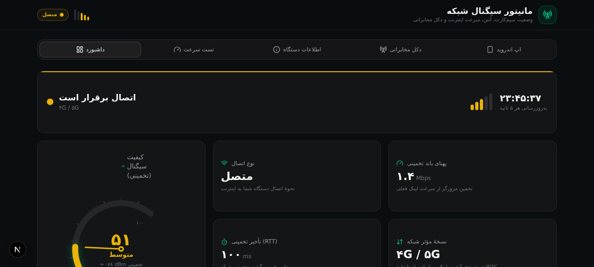

# 📡 مانیتور سیگنال شبکه | Network Signal Monitor

وب‌اپلیکیشن و اپ اندروید کامل برای مانیتورینگ لحظه‌ای وضعیت شبکه، سیم‌کارت، آنتن و سرعت اینترنت — با رابط کاربری کاملاً فارسی (RTL) و تم تیره.

A Persian (RTL) web dashboard + complete Android app for real-time network, SIM, signal and internet speed monitoring.



## ✨ امکانات وب‌اپ

- **داشبورد زنده** — گیج کیفیت سیگنال (۰-۱۰۰ + dBm تخمینی)، نوارهای آنتن ۵ تایی، ساعت زنده، تشخیص فوری آنلاین/آفلاین
- **تست سرعت واقعی** — دانلود جریانی ۱۲ مگابایتی، آپلود ۴ مگابایتی، پینگ (۸ نمونه) و جیتر با گیج متحرک زنده
- **نمودار روند + تاریخچه** — ذخیرهٔ نتایج در دیتابیس SQLite (Prisma) و نمودار دانلود/آپلود/پینگ
- **اطلاعات دستگاه** — IP عمومی، باتری، سیستم‌عامل، مرورگر، جدول کامل Network Information API + GPS
- **PWA** — قابل نصب روی موبایل با manifest و آیکن

## 📱 اپ اندروید (پوشهٔ `android-app/`)

پروژهٔ کامل Android Studio با Kotlin و Material 3:

| قابلیت | توضیح |
|---|---|
| قدرت سیگنال واقعی | dBm، ASU، سطح ۰-۴، RSRP/RSRQ/RSSI/SNR برای LTE/5G |
| نوع شبکه | نگاشت کامل 5G NR / LTE / HSPA+ / 3G / EDGE با نسخهٔ نسل |
| دکل سروینگ | CID، PCI، TAC/LAC، EARFCN، MCC/MNC + سلول‌های همسایه (هر ۳ ثانیه) |
| فاصله تا دکل | GPS + مختصات دکل از [OpenCelliD](https://opencellid.org) → فاصلهٔ هاورساین به متر |
| دو سیم‌کارت | سابسکریپشن‌های فعال با اپراتور و وضعیت هر سیم |
| تست سرعت | ۴ جریان موازی دانلود ۲۵MB، آپلود و پینگ با جیتر |
| آیکن | mipmap کامل در ۵ تراکم |

**دانلود ZIP آماده:** `public/downloads/android-signal-app.zip` (همچنین از تب «اپ اندروید» داخل خود برنامه)

راهنمای کامل ساخت APK در [`android-app/README.md`](android-app/README.md) آمده است (minSdk 26 = اندروید ۸ به بالا).

## 🚀 راه‌اندازی وب‌اپ

```bash
# نصب وابستگی‌ها
bun install   # یا npm install

# دیتابیس (SQLite + Prisma)
bun run db:push

# اجرا در حالت توسعه
bun run dev   # http://localhost:3000
```

## 🛠 تکنولوژی

- **Next.js 16 (App Router) + TypeScript 5**
- **Tailwind CSS 4 + shadcn/ui** (تم تیره، سبز زمردی)
- **Prisma + SQLite** برای تاریخچهٔ تست‌ها
- **Recharts** برای نمودار روند، **Framer Motion** برای انیمیشن‌ها
- **Kotlin + Material 3 + Coroutines** برای اندروید

## 📁 ساختار

```
├── src/
│   ├── app/api/            # ping، speedtest (download/upload/history)، network-info
│   ├── components/network/ # گیج، نوار آنتن، تب‌ها، نمودار
│   ├── hooks/              # use-network-info (useSyncExternalStore)، use-speedtest
│   └── lib/persian.ts      # ارقام و برچسب‌های فارسی
├── android-app/            # پروژهٔ کامل Android Studio (Kotlin)
├── public/downloads/       # ZIP آمادهٔ اپ اندروید
└── prisma/schema.prisma    # مدل SpeedTestResult
```

## ⚠️ نکتهٔ مهم

مرورگرها به دلایل امنیتی به شناسهٔ دکل (CID/PCI)، dBm سخت‌افزاری و اطلاعات اپراتور دسترسی نمی‌دهند؛ مقادیر وب‌اپ «تخمینی» است. اندازه‌گیری دقیق و فاصلهٔ واقعی تا دکل فقط با اپ اندروید ممکن است.

## 📄 مجوز

MIT — برای اطلاع به [مجوز مایکروسافت OpenCelliD](https://opencellid.org) برای استفاده از دیتابیس دکل‌ها.
