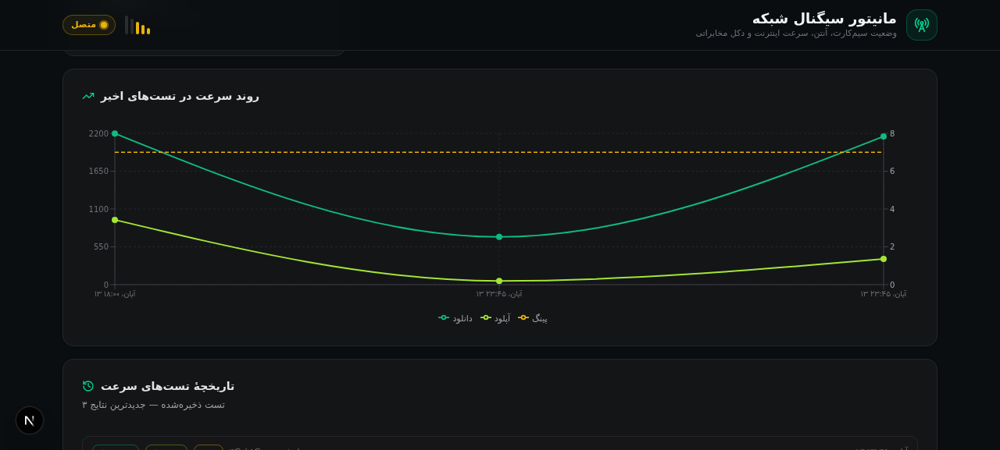

# 📡 مانیتور سیگنال شبکه | Network Signal Monitor

وب‌اپلیکیشن و اپ اندروید کامل برای مانیتورینگ لحظه‌ای وضعیت شبکه، سیم‌کارت، آنتن، سرعت اینترنت و دکل مخابراتی — با رابط کاربری کاملاً فارسی (RTL)، تم تیره زمردی و معماری مدرن.

A Persian (RTL) web dashboard + complete Android (Kotlin) app for real-time network, SIM, signal, internet speed and cell-tower monitoring.


## ✨ امکانات وب‌اپ

- **داشبورد زنده** — گیج کیفیت سیگنال (۰ تا ۱۰۰ + dBm تخمینی)، نوارهای آنتن ۵ تایی، ساعت زنده، تشخیص فوری آنلاین/آفلاین
- **تست سرعت واقعی** — پینگ (۸ نمونه، میانگین ۴ بهترین) → دانلود جریانی ۱۲ مگابایتی با `ReadableStream` → آپلود ۴ مگابایتی؛ همه‌چیز زنده روی گیج متحرک
- **نمودار روند + تاریخچه** — ذخیرهٔ نتایج در SQLite (Prisma) و نمودار دانلود/آپلود/پینگ با ارقام فارسی

  

- **اطلاعات دستگاه** — IP عمومی، باتری (Battery API)، سیستم‌عامل و مرورگر، جدول کامل Network Information API و GPS
- **PWA** — قابل نصب روی موبایل (`manifest.webmanifest` + آیکن‌ها)
- **دقت و پایداری** — state تست سرعت در سطح پوسته نگه داشته می‌شود؛ تعویض تب وسط تست، آن را قطع نمی‌کند

## 📱 اپ اندروید (پوشهٔ `android-app/`)

پروژهٔ کامل Android Studio با Kotlin، Material 3 و رابط کاملاً فارسی — دقیقاً همان چیزی که مرورگر نمی‌تواند نشان دهد:

| قابلیت | توضیح |
|---|---|
| قدرت سیگنال واقعی | dBm، ASU، سطح ۰-۴، RSRP/RSRQ/RSSI/SNR برای LTE/5G (با پشتیبانی API 26+) |
| نوع شبکه | نگاشت کامل 5G NR / LTE / HSPA+ / 3G / EDGE با نسخهٔ نسل |
| دکل سروینگ | CID، PCI، TAC/LAC، EARFCN، MCC/MNC + سلول‌های همسایه (هر ۳ ثانیه) |
| فاصله تا دکل | GPS + مختصات دکل از [OpenCelliD](https://opencellid.org) → فاصلهٔ هاورساین به متر + جهت قطب‌نما |
| دو سیم‌کارت | سابسکریپشن‌های فعال با اپراتور و وضعیت هر سیم |
| تست سرعت | ۴ جریان موازی دانلود ۲۵MB، آپلود و پینگ با جیتر |

**دانلود ZIP آماده:** [`public/downloads/android-signal-app.zip`](public/downloads/android-signal-app.zip) — همچنین از تب «اپ اندروید» داخل خود برنامه.

راهنمای کامل ساخت APK در [`android-app/README.md`](android-app/README.md) آمده است (minSdk 26 = اندروید ۸ به بالا).

## 🚀 راه‌اندازی وب‌اپ

```bash
# ۱) نصب وابستگی‌ها
bun install        # یا npm install

# ۲) تنظیم دیتابیس (SQLite + Prisma)
echo 'DATABASE_URL="file:./../db/custom.db"' > .env
bun run db:push

# ۳) اجرا
bun run dev        # http://localhost:3000
```

## 🏗 معماری

```
├── src/
│   ├── app/
│   │   ├── api/ping/                        # پاسخ فوری برای اندازه‌گیری تأخیر
│   │   ├── api/speedtest/download/          # جریان بایت تصادفی (تا ۲۵MB) برای تست دانلود
│   │   ├── api/speedtest/upload/            # مصرف بدنهٔ POST و شمارش بایت برای تست آپلود
│   │   ├── api/speedtest/history/           # GET/POST نتایج (Prisma + SQLite)
│   │   └── api/network-info/                # IP، مرورگر، OS
│   ├── components/network/                  # گیج قوسی SVG، نوار آنتن، ۵ تب، نمودار
│   ├── hooks/
│   │   ├── use-network-info.ts              # state زنده با useSyncExternalStore
│   │   └── use-speedtest.ts                 # ماشین حالت idle→ping→download→upload→done
│   └── lib/persian.ts                       # ارقام فارسی، امتیاز کیفیت، برچسب‌ها
├── android-app/                             # پروژهٔ کامل Android Studio (Kotlin)
├── public/downloads/                        # ZIP آمادهٔ اپ اندروید
└── prisma/schema.prisma                     # مدل SpeedTestResult
```

**موتور تست سرعت سمت کلاینت:** پینگ ۸ نمونه → میانگین ۴ بهترین؛ دانلود جریانی با خواندن chunk ها و محاسبهٔ لحظه‌ای؛ سقف زمانی ۱۵ ثانیه برای دانلود (سرعت از بایت واقعی دریافتی). نتیجه به‌صورت خودکار (فقط یک‌بار برای هر اجرا) در دیتابیس ذخیره می‌شود.

## 🛠 تکنولوژی

- **Next.js 16 (App Router) + TypeScript 5** (strict)
- **Tailwind CSS 4 + shadcn/ui** (تم تیره، سبز زمردی)
- **Prisma + SQLite** برای تاریخچهٔ تست‌ها
- **Recharts** برای نمودار روند، **Framer Motion** برای انیمیشن‌ها، **Sonner** برای نوتیفیکیشن
- **Kotlin + Material 3 + Coroutines + FusedLocation** برای اندروید

## ⚠️ نکتهٔ مهم: محدودیت مرورگر

مرورگرها به دلایل امنیتی به شناسهٔ دکل (CID/PCI)، dBm سخت‌افزاری و اطلاعات اپراتور دسترسی نمی‌دهند؛ مقادیر وب‌اپ «تخمینی» است. اندازه‌گیری دقیق (dBm واقعی، دکل سروینگ، فاصلهٔ واقعی تا دکل) فقط با اپ اندروید ممکن است.

## 📄 مجوز

[MIT](LICENSE)
